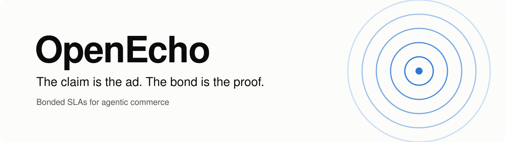
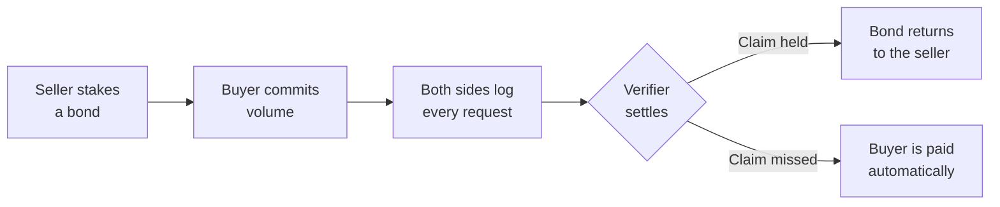
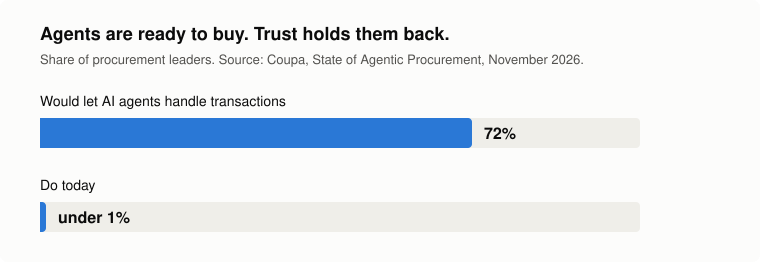
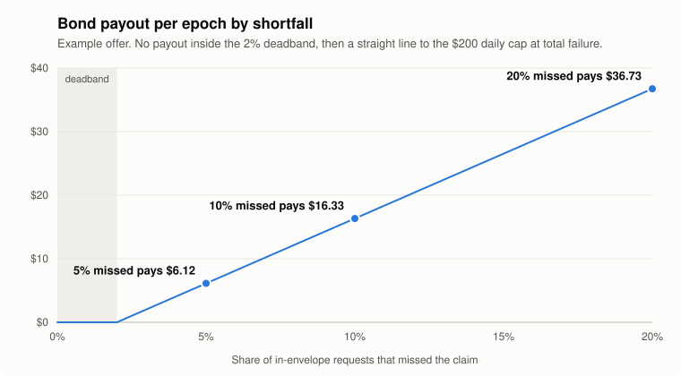

<picture>
  <source media="(prefers-color-scheme: dark)" srcset="https://raw.githubusercontent.com/openecho-ai/.github/main/profile/assets/banner-dark.svg">
  
</picture>

For a century, commerce ran on persuasion. Whoever bought the most attention won. AI agents end that era, because an agent cannot be charmed, only convinced.

OpenEcho is building the trust layer for what comes next: an economy where every commercial claim is staked, machine-verifiable, and settled automatically.

## What we build

**The bonded SLA: the SLA that pays itself.** A seller stakes money behind a measurable claim. When production data shows the claim held, the bond comes back. When it shows a miss, the buyer is paid automatically. No tickets, no credit paperwork, no persuasion.

A bonded SLA has three properties. Anything missing one is something else.

1. **Posted collateral.** The seller stakes money before delivery.
2. **Shared measurement.** Performance is judged from production data both parties hold.
3. **Automatic payout.** A miss pays the buyer, with no claim to file.

An ordinary SLA has none of the three. It promises credits, and someone has to chase them.

Sellers stop paying to be seen and start putting money behind being right.

## Why now

Agents are ready to buy. Trust is what holds them back.

<picture>
  <source media="(prefers-color-scheme: dark)" srcset="https://raw.githubusercontent.com/openecho-ai/.github/main/profile/assets/trust-gap-dark.svg">
  
</picture>

The missing piece is a guarantee an agent can verify and enforce. That is what a bonded SLA is.

| | | Source |
|---|---|---|
| **72%** | of procurement leaders would let AI agents handle transactions. Fewer than 1% do. | Coupa, State of Agentic Procurement, November 2026 |
| **$600 billion** | lost to downtime each year by the Global 2000, about $900,000 per hour per company | Splunk, The Hidden Costs of Downtime, 2026 |
| **$33B to $177B** | growth in enterprise AI spend in a single year | Menlo Ventures, The State of Enterprise AI, 2026 |

Enterprises are spending more on AI every quarter, losing more when it fails, and recovering a sliver through service credits someone has to chase.

## What it looks like in practice

These are illustrative scenarios, not customer stories.

**A challenger wins the account it could never get a meeting for.**
An inference provider is as fast as the incumbent and has no way to prove it. It publishes a bonded SLA: a stated speed on a named model, with collateral behind it. The buyer's router sees an enforceable guarantee where the incumbent offers a brochure, and shifts volume. Every clean day, the bond stays whole.

**A product team stops chasing credits.**
Launch week, and a provider slows down under load. Nobody files a ticket. The settlement receipt shows the shortfall, and the payout reaches the buyer from the bond. The team finds out from the receipt, not from an angry customer.

**A procurement agent makes a choice it can defend.**
An agent compares three offers for the same workload. Two make claims. One stakes them. The agent selects the bonded SLA, attaches the terms to its recommendation, and a human approves in one click, because the downside is already covered.

**A buyer commits, and gets a better price for it.**
The buyer agrees to a minimum volume. The seller, now staking against committed revenue, sharpens its price. Both sides have skin in the game, and both can plan.

**On the horizon: the same rail, new markets.**
A carrier stakes on-time pickup, and the shipper is paid when a load runs late. A network provider stakes uptime, and the customer is paid for every hour it misses. Anywhere data can settle a claim, a bond can back it.

## Advertising versus bonded SLAs

| | Advertising | Bonded SLAs |
|---|---|---|
| **What the seller pays for** | Attention | Being right |
| **Where the money goes** | To a platform, whatever happens | Back to the seller on delivery, to the buyer on a miss |
| **What backs the claim** | A budget | Collateral |
| **What an agent can check** | Nothing | Every settlement, recomputed from the data |
| **What a bot can fake** | Clicks and impressions | Nothing. Money moves only on verified delivery |

## A seller always knows the downside

The payout is zero inside an agreed deadband, then rises in a straight line to a cap set before the contract starts.

<picture>
  <source media="(prefers-color-scheme: dark)" srcset="https://raw.githubusercontent.com/openecho-ai/.github/main/profile/assets/payout-curve-dark.svg">
  
</picture>

## Why sellers say yes

- **You write your own claim.** Stake a level you already hit.
- **The bond comes back.** Ad spend is gone the day it is spent. A bond returns in full when you deliver.
- **You stake against committed volume.** The buyer commits in the same contract.
- **Your downside is capped.** The maximum loss is the bond, known before you start.
- **Kept promises compound.** Every settled contract adds to a record no ad budget can buy.

## The protocol

Open schemas, a settlement lifecycle, and a reference verifier anyone can run. Any third party will be able to recompute any settlement and get the same answer. Publishing soon.

## Who it is for

- **Buyers:** Contracted proof over hype. Get paid automatically when a provider misses.
- **Challenger sellers:** Stake the claim, win the volume. Let performance do the selling.
- **Agent and gateway builders:** Give your agents guarantees they can enforce.

## Where we are going

- **Now:** bonded inference, the first bonded SLA, settled automatically.
- **Next:** signed receipts, escrow and surety partners, one-step adoption inside the gateways teams already use.
- **Horizon:** every measurable claim in commerce carries a bond, and advertising becomes accountability.
